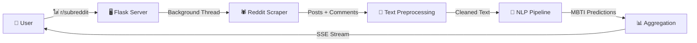
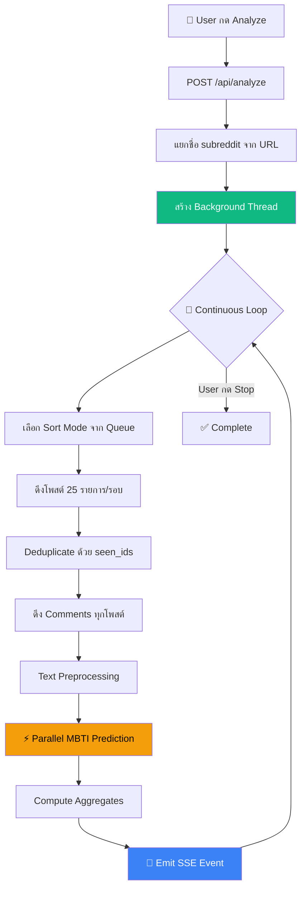
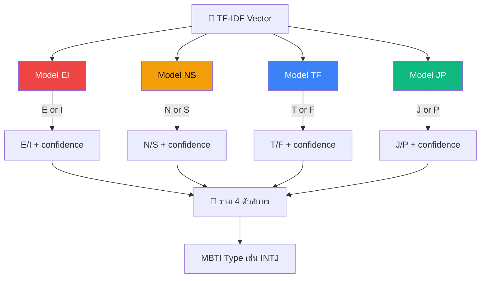
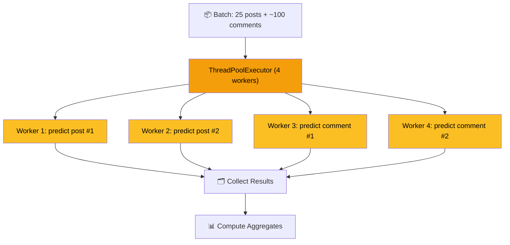
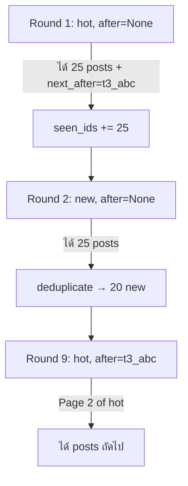
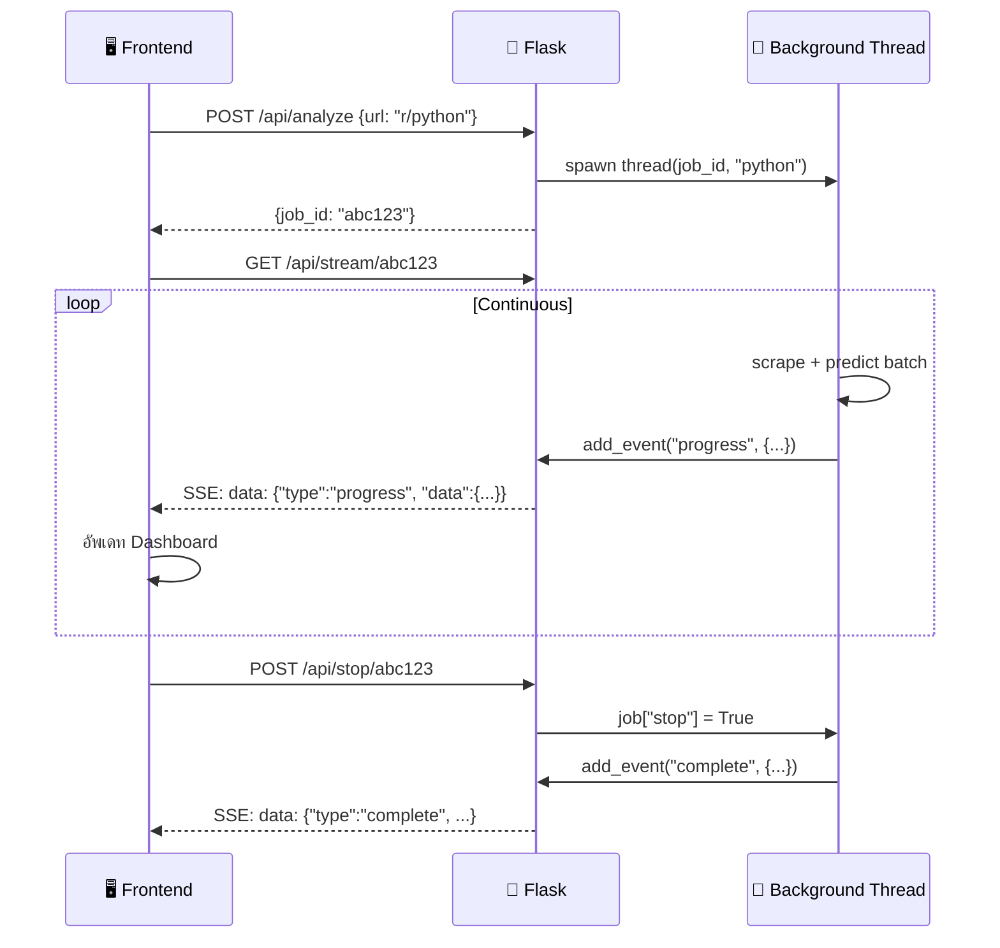
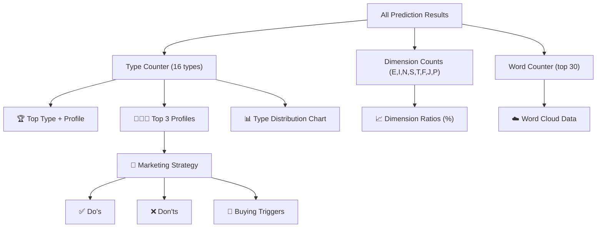

# 🧠 Reddit Community MBTI Analyzer — System Workflow

## ภาพรวมระบบ (System Overview)

ระบบนี้เป็น **Web Application** สำหรับวิเคราะห์บุคลิกภาพ MBTI ของชุมชน Reddit โดยใช้ **NLP (Natural Language Processing)** ทำนายประเภท MBTI จากข้อความโพสต์และคอมเมนต์ แล้วแสดงผลแบบ **Real-time** ผ่าน Dashboard



---

## Tech Stack

| Component | Technology | หน้าที่ |
|---|---|---|
| **Backend** | Flask (Python) | Web server, API routing, SSE streaming |
| **ML Models** | scikit-learn (Logistic Regression via joblib) | ทำนาย MBTI 4 มิติ |
| **Text Vectorizer** | TF-IDF (scikit-learn) | แปลงข้อความเป็น feature vector |
| **Data Source** | Reddit `.json` endpoint (old.reddit.com) | ดึงโพสต์และคอมเมนต์โดยไม่ใช้ API key |
| **Concurrency** | `threading` + `ThreadPoolExecutor` | Background job + parallel prediction |
| **Real-time** | Server-Sent Events (SSE) | สตรีมผลลัพธ์ให้ Frontend แบบ real-time |
| **Frontend** | HTML/CSS/JavaScript (Vanilla) | Dashboard + Text Predictor UI |

---

## โครงสร้างไฟล์ (Project Structure)

```
d:\mbti_big\
├── reddit_app.py              # 🎯 Main application (812 lines)
│                              #    - Flask routes, scraper, NLP pipeline
│                              #    - Parallel prediction, SSE streaming
├── mbti_types.py              # 📋 MBTI 16-type profiles data
│                              #    - traits, strengths, weaknesses
│                              #    - marketing strategies, careers
├── mbti_dimension_models.pkl  # 🤖 Pre-trained ML models (4 binary classifiers)
├── tfidf_vectorizer.pkl       # 📐 TF-IDF vectorizer (trained on MBTI dataset)
├── templates/
│   ├── reddit_dashboard.html  # 📊 Community analyzer dashboard
│   └── text_predictor.html    # ✍️ Individual text prediction page
└── static/
    ├── reddit_style.css       # 🎨 Dashboard styling
    ├── predictor_style.css    # 🎨 Text predictor styling
    └── nav.css                # 🎨 Navigation bar styling
```

---

## 📍 Data Pipeline (กระบวนการหลัก)

### Pipeline แบบ Community Analyzer (Reddit Scraping Mode)



### Pipeline แบบ Text Predictor (Single Text Mode)


---

## 🧹 Text Preprocessing Pipeline

ข้อความดิบจาก Reddit ถูกทำความสะอาดก่อนเข้าโมเดล 2 ขั้นตอน:

### ขั้นที่ 1: `clean_text(text)`
```
ข้อความดิบ → ลบ URL → ลบ Markdown links → ลบ Special chars → Lowercase → ลบ whitespace ซ้ำ
```

| ขั้นตอน | Regex | ตัวอย่าง |
|---|---|---|
| ลบ URL | `http\S+\|www\S+\|https\S+` | `Check this https://example.com` → `Check this` |
| ลบ Markdown links | `\[.*?\]\(.*?\)` | `[click here](url)` → `` |
| เหลือแค่ตัวอักษร | `[^a-zA-Z\s]` → `" "` | `I'm 99% sure!` → `I m sure` |
| Lowercase + trim | `.strip().lower()` | `HELLO World` → `hello world` |

### ขั้นที่ 2: `remove_stop_words(text)`
- ลบ **Stop Words** (200+ คำ) เช่น `the, is, a, reddit, lol, deleted`
- ลบคำที่สั้นกว่า 3 ตัวอักษร
- เก็บ Word list สำหรับนับ Word Frequency

### ขั้นที่ 3: TF-IDF Vectorization
```python
text_vec = vectorizer.transform([cleaned_text])
# แปลงข้อความเป็น sparse matrix ของ TF-IDF features
# vectorizer ถูก train ไว้ล่วงหน้าจาก MBTI dataset ขนาดใหญ่
```

> [!NOTE]
> Vectorizer (`tfidf_vectorizer.pkl`) ถูก train จากชุดข้อมูล MBTI ที่มีข้อความจาก PersonalityCafe forum
> โมเดลจะใช้ **คำศัพท์และรูปแบบการเขียน** เป็นตัวชี้วัด ไม่ใช่ความหมายของข้อความ

---

## 🤖 NLP Prediction Pipeline

### Model Architecture: 4 Binary Classifiers

ระบบใช้ **4 โมเดลแยกกัน** สำหรับแต่ละมิติของ MBTI:



### Bias Correction System

โมเดลมี **bias ตามธรรมชาติ** (เพราะข้อมูล training ไม่สมดุล) ระบบจึงมี Bias Correction:

```python
# ตัวอย่าง: ถ้าโมเดลให้ raw probability I=0.65, E=0.35
# Bias Correction weights: E=1.13, I=0.87

corrected_E = 0.35 × 1.13 = 0.3955
corrected_I = 0.65 × 0.87 = 0.5655

# Re-normalize ให้รวมเป็น 1.0:
final_E = 0.3955 / (0.3955 + 0.5655) = 0.411
final_I = 0.5655 / (0.3955 + 0.5655) = 0.589
```

**ค่า Bias Correction ปัจจุบัน** (calibrate จาก model accuracy):

| มิติ | Model Accuracy | ค่า Correction | เหตุผล |
|---|---|---|---|
| **E/I** | I=68%, E=60% | E=1.13, I=0.87 | โมเดล over-predict I → ดัน E ขึ้น |
| **N/S** | N=75%, S=73% | N=0.95, S=1.05 | ใกล้เคียงกัน ปรับเล็กน้อย |
| **T/F** | T=63%, F=63% | T=1.00, F=1.00 | สมดุล ไม่ต้องปรับ |
| **J/P** | P=64%, J=58% | J=1.10, P=0.90 | โมเดล over-predict P → ดัน J ขึ้น |

### คำนวณ 16 Types Probability (Text Predictor Mode)

สำหรับหน้า Text Predictor ระบบคำนวณ probability ของทั้ง 16 types:

```
P(INTJ) = P(I) × P(N) × P(T) × P(J)
P(ENTP) = P(E) × P(N) × P(T) × P(P)
... ครบ 16 types
```

แล้วเรียงลำดับจากมากไปน้อย แสดง Top 5 alternatives

---

## ⚡ Parallel Processing Architecture

### Layer 1: Background Thread (Job Level)

```python
# เมื่อ user กด Analyze → สร้าง daemon thread ทำงานเบื้องหลัง
thread = threading.Thread(target=run_analysis_job, args=(job_id, subreddit), daemon=True)
thread.start()
# Flask ตอบ job_id ทันที → Frontend เริ่ม listen SSE
```

- **Thread-safe** ด้วย `threading.Lock` (`jobs_lock`) สำหรับ shared state
- **Graceful stop** ด้วย flag `job["stop"]` ที่ตรวจทุก iteration

### Layer 2: ThreadPoolExecutor (Prediction Level)

```python
# ภายใน background thread → ใช้ ThreadPoolExecutor สำหรับ prediction
with ThreadPoolExecutor(max_workers=4) as executor:
    for post in posts:
        future = executor.submit(predict_mbti_single, cleaned, vectorizer, models)
        future_to_post[future] = post
    
    for future in as_completed(future_to_post):
        mbti_type, dim_details = future.result(timeout=30)
```



> [!IMPORTANT]
> **ทำไมใช้ Thread ไม่ใช่ Process?**
> - ML models (scikit-learn) ปล่อย GIL ระหว่าง `.predict_proba()` เพราะ computation เกิดใน C/NumPy layer
> - Threads ใช้ memory ร่วมกัน → models/vectorizer ไม่ต้อง copy → ประหยัด RAM
> - Thread-safe เพราะ models เป็น **read-only** (ไม่มีการ write ขณะ predict)

### Concurrency สรุป

```
Main Flask Thread
├── /api/analyze  → spawn Background Thread
│                    ├── Scrape posts (sequential, rate-limited)
│                    ├── Scrape comments per post (sequential, 3s delay)
│                    └── predict_posts_parallel()
│                         └── ThreadPoolExecutor(4 workers)
│                              ├── predict_mbti_single(post_1)
│                              ├── predict_mbti_single(post_2)
│                              ├── predict_mbti_single(comment_1)
│                              └── predict_mbti_single(comment_2)
├── /api/stream   → SSE generator (polling job events)
└── /api/stop     → set job["stop"] = True
```

---

## 🕷️ Reddit Scraping Strategy

### Sort Queue System

ระบบสลับ Sort Mode เป็นวงรอบเพื่อดึงข้อมูลที่หลากหลาย:

```
Round 1: hot
Round 2: new
Round 3: rising
Round 4: top/day
Round 5: top/week
Round 6: top/month
Round 7: top/year
Round 8: top/all
Round 9: hot (กลับมาเริ่มใหม่ + ใช้ pagination token)
...
```

### Pagination & Deduplication



- **Post dedup**: ใช้ `seen_ids` (Set) เก็บ post ID ที่เคยเห็น
- **Comment dedup**: ใช้ `seen_comment_ids` สร้างจาก `{post_id}_{author}_{hash(body)}`
- **Pagination**: เก็บ `after_tokens` แยกตาม sort mode

### Rate Limiting & Error Handling

| สถานการณ์ | การจัดการ |
|---|---|
| HTTP 429 (Rate Limit) | Wait 10s × attempt, max 3 retries |
| Timeout | Wait 5s, retry |
| Connection Error | Wait 8s, retry |
| HTTP 301/302 (Redirect) | Return None, skip |
| ไม่มีโพสต์ใหม่ | สลับ sort mode ถัดไป |
| Round 1 ว่างเปล่า | แจ้ง error "ไม่พบ subreddit" |
| **Between comment fetches** | **3 วินาที delay** |
| **Between rounds** | **3 วินาที delay** |

### Comment Scraping

ทุกโพสต์ใหม่ → ดึง comments ด้วย recursive tree traversal:

```python
# GET old.reddit.com/r/sub/comments/post_id.json
# params: limit=500, depth=10, sort=new

def _extract_all_comments(node):
    # Recursive: t1 (comment) → extract body
    #            Listing → iterate children
    #            more → skip
    #            replies → recurse deeper
```

---

## 📡 Real-time Streaming (SSE)

### Event Flow



### Event Types

| Event Type | เมื่อไหร่ | ข้อมูลที่ส่ง |
|---|---|---|
| `status` | เริ่มดึงข้อมูล, สลับ mode | message, phase, sort_mode |
| `progress` | วิเคราะห์ batch เสร็จ | batch_results, type_distribution, dim_ratios, top3_profiles, word_frequencies |
| `complete` | user กด stop | สรุปจำนวนทั้งหมด |
| `error` | ไม่พบ subreddit | error message |
| `timeout` | เกิน 10 นาที | timeout message |

### SSE Implementation

```python
# Server: Generator function ที่ poll events ทุก 0.5 วินาที
def generate():
    last_idx = 0
    while True:
        events = job["events"][last_idx:]  # ดึง events ใหม่
        last_idx = len(job["events"])
        for event in events:
            yield f"data: {json.dumps(event)}\n\n"
        if completed:
            break
        time.sleep(0.5)  # poll interval

# Client: EventSource API
const source = new EventSource(`/api/stream/${jobId}`);
source.onmessage = (event) => {
    const data = JSON.parse(event.data);
    updateDashboard(data);
};
```

---

## 📊 Aggregation & Output

หลังทุก batch, ระบบคำนวณ aggregates:



### Output Data Structure (per progress event)

```json
{
    "total_processed": 150,
    "total_scraped": 50,
    "total_comments": 100,
    "type_distribution": {"INTJ": 15, "INFP": 12, "ENTP": 10, ...},
    "dim_ratios": {
        "EI": {"E": 45.2, "I": 54.8},
        "NS": {"N": 68.3, "S": 31.7},
        "TF": {"T": 52.1, "F": 47.9},
        "JP": {"J": 41.5, "P": 58.5}
    },
    "top_type": {"type": "INTJ", "nickname": "The Architect", ...},
    "top3_profiles": [
        {"type": "INTJ", "count": 15, "pct": 10.0, "marketing": {...}},
        {"type": "INFP", "count": 12, "pct": 8.0, "marketing": {...}},
        {"type": "ENTP", "count": 10, "pct": 6.7, "marketing": {...}}
    ],
    "word_frequencies": [["python", 45], ["code", 38], ...],
    "marketing": {"approach": "...", "do": [...], "dont": [...]}
}
```

---

## 🔄 Two Modes of Operation

### Mode 1: Community Analyzer (`/`)
- **Input**: Subreddit URL หรือชื่อ
- **Process**: Continuous scraping + parallel prediction
- **Output**: Real-time dashboard ด้วย SSE
- **Use case**: วิเคราะห์ภาพรวมบุคลิกภาพของชุมชน

### Mode 2: Text Predictor (`/text`)
- **Input**: ข้อความภาษาอังกฤษ (≥ 20 ตัวอักษร)
- **Process**: Single prediction, synchronous
- **Output**: MBTI type + confidence + top 5 alternatives + full profile
- **Use case**: ทำนาย MBTI จากข้อความเดียว

---

## 🛡️ Thread Safety Design

| Shared Resource | Protection | Strategy |
|---|---|---|
| `jobs` dict | `jobs_lock` (threading.Lock) | ทุกการ read/write ต้องใช้ lock |
| ML Models | None needed | **Read-only** after loading → thread-safe |
| TF-IDF Vectorizer | None needed | **Read-only** → thread-safe |
| `word_counter` | Single-thread access | อยู่ใน background thread เดียว ไม่ต้อง lock |
| SSE event list | `jobs_lock` | append events ภายใน lock |
